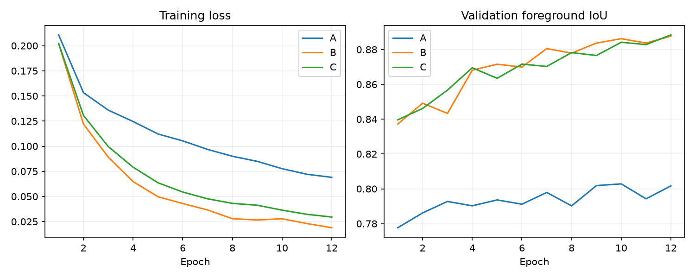
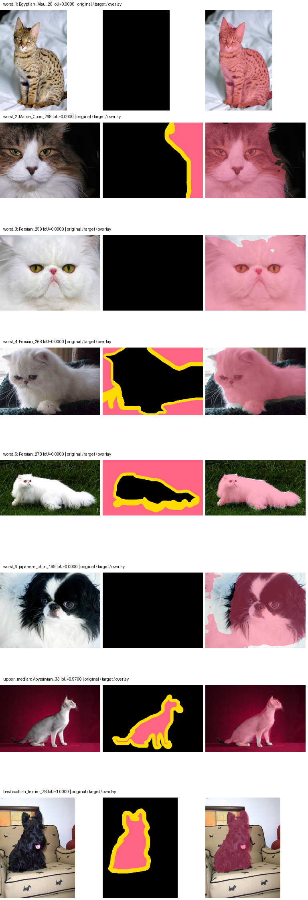
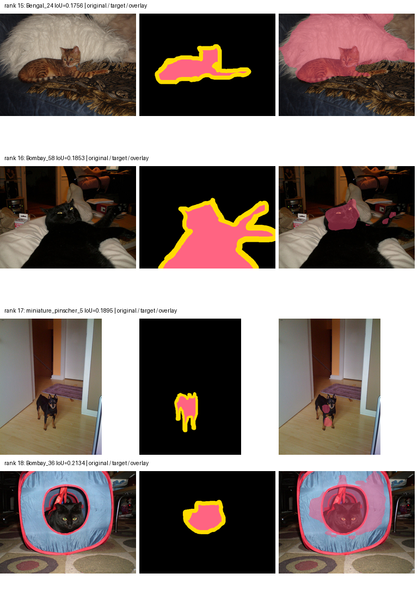

# Pet foreground segmentation: technical report

## Result and intended use

The project predicts pet foreground pixels, then displays a mask, overlay and background replacement in a local Streamlit app. Torchvision LR-ASPP with MobileNetV3-Large provides a compact transfer-learning baseline suited to CPU inference. The ImageNet-pretrained backbone initializes feature extraction; a new two-class head learns pet/background segmentation. The output is a binary semantic mask: it does not separate individual pets or estimate transparency.

Three comparable CPU experiments were completed. Experiment C, full fine-tuning with augmentation, won on validation foreground IoU (**0.888393**). Its frozen 256-resolution checkpoint achieved **0.939749 foreground IoU on 3,669 official test images**. Smaller inputs were faster but failed the predeclared validation-quality constraint, so deployment retains 256. These scores exclude ambiguous outline pixels.

The [generated tables](../artifacts/reports/results.md), [model card](MODEL_CARD.md) and [verification record](../VERIFICATION.md) accompany this report. All measurements below come from retained artifacts.

## Data and metric protocol

A complete Oxford-IIIT Pet audit found 7,349 readable image/mask pairs: a **2,944-image training pool**, **736 validation images**, and **3,669 official test images**. The approximately 80/20 split within official trainval is breed-stratified and grouped by decoded image content, using seed 42. No corrupt-pair exclusions or exact decoded cross-partition duplicates were found. Exact-content checks do not detect every near-duplicate or establish independence from ImageNet pretraining.

Across audited pairs, pixels are 58.91% background, 29.52% pet and 11.58% ignored outline. Raw trimap labels map **1 → pet 1, 2 → background 0, 3 → ignored 255**. Ignored pixels contribute neither loss nor metrics and are not a third predicted class. A high IoU therefore does not prove accurate fur or whisker boundaries. Exported PNG masks use a separate visualization convention: 0 is background and 255 is white pet foreground.

Images use bilinear square resizing and ImageNet normalization; masks use nearest-neighbor resizing. Geometric transforms apply to image and mask together. Evaluation resizes logits to the original annotation dimensions before argmax, then accumulates one confusion matrix over all nonignored pixels. Foreground IoU is TP/(TP+FP+FN), and Dice is 2TP/(2TP+FP+FN). Mean IoU averages the defined background and foreground IoUs. Pixel accuracy is secondary because background is common. Undefined metrics are null rather than perfect; undefined per-image IoUs are omitted from ranking.

The manifest SHA-256 is `cfd32d2dd01ea46fdc53b1aeeb1851e204bc78c3ae3f9707aa82411c4f9b74f1`. The audit, actual IDs, raw annotation README and overlays are retained. Structural validity did not establish semantic annotation correctness: visually inconsistent official test labels were discovered during final error analysis below. [DATASET.md](DATASET.md) covers attribution and the upstream licensing caveat.

## Controlled training experiments

No CUDA GPU or connected Colab session was available. The documented CPU fallback used the **same 1,000 breed-stratified training IDs** in A/B/C; the other 1,944 training-pool images were unused. Validation and test remained full. No paid compute was used. The full-data GPU configs and Colab notebook are optional reproduction routes; Colab/Drive/CUDA execution is not claimed.

All runs independently started with identical seeded tensors: ImageNet1K V1 backbone plus a newly initialized head, with initial tensor SHA-256 `42a610ee0897a8d31e991ed8f915d8f8404c527b9332c15b70b0665fd5f35165`. Common settings were seed 42, 256 input, batch size 2, AdamW, head LR 0.001, backbone LR 0.0001, weight decay 0.0001, and cross-entropy ignoring 255. Early stopping allowed three non-improving epochs after at least three epochs, within a 12-epoch maximum. All runs reached **12 epochs / 6,000 optimizer steps**.

| Run | Training change | Best epoch (1-based) | Validation pet IoU | First → last epoch loss |
|---|---|---:|---:|---:|
| A | Train head; freeze backbone parameters and BatchNorm statistics | 10 | 0.802834 | 0.21075 → 0.06901 |
| B | Fine-tune the full network | 12 | 0.887705 | 0.20209 → 0.01892 |
| C | B plus paired horizontal flips and image-only color jitter | 12 | 0.888393 | 0.20225 → 0.02953 |

C uses flip probability 0.5 and brightness/contrast/saturation jitter 0.2, hue 0.05. Checkpoints and experiments were selected by validation pet IoU only; exact ties would prefer A, then B, then C. Full fine-tuning improved validation IoU over A by about 0.0849. C exceeded B by only **0.000688**, or **0.0688 percentage points**. This selects C under the rule but does not establish a repeatable augmentation benefit from one seed.

The curves show decreasing training loss in all runs, with B/C validation trajectories close together and above A. C's loss is computed on augmented inputs, so comparing its absolute training loss with B is not a direct generalization test. B/C achieved their highest recorded validation score at the budget limit; no claim of converged optimum is made.

Before A/B/C, a separate two-image, 30-step diagnostic reduced loss from 0.80032 to 0.01557 and reached 0.99228 IoU on those same training images. A separate four-step full-model smoke run had finite loss. These diagnose pipeline behavior and were excluded from final selection. A/B/C ran concurrently in separate one-thread CPU processes, so their saved wall times are descriptive rather than a training-speed comparison.

## CPU resolution optimization

Weights were fixed while comparing 256, 192 and 128. The predeclared policy chose the smallest input with no more than **0.02 absolute validation foreground IoU loss** from 256 and lower median pipeline latency; otherwise it retained 256. Quality used all 736 validation images.

| Input | Validation pet IoU | IoU loss from 256 | Forward median / p95 (ms) | Pipeline median / p95 (ms) | Outcome |
|---|---:|---:|---:|---:|---|
| 256 | 0.888393 | 0 | 42.92 / 52.11 | 105.42 / 135.90 | Retained |
| 192 | 0.864532 | 0.023861 | 28.14 / 34.34 | 92.84 / 119.56 | Rejected: quality loss |
| 128 | 0.461857 | 0.426536 | 18.95 / 23.22 | 83.45 / 111.72 | Rejected: quality loss |

Timing used an AMD Ryzen 7 5800H on Windows, Python 3.12.14, torch 2.9.1+cpu / torchvision 0.24.1+cpu, FP32, batch 1 and one torch thread. The same 100 breed-stratified validation images were preloaded. Each resolution/path had 10 warm-up calls and 100 timed calls; all six resolution/path combinations were shuffled per image/call using seed 42. No training or other project inference ran during this benchmark.

Forward timing measures the model. The in-memory pipeline includes preprocessing, forward, original-size logit restoration and argmax; it excludes image loading/decoding, PNG encoding, browser rendering and UI overhead. It is not an upload-to-download latency measurement.

The 192 pipeline median was about 11.9% lower, but its 2.386 percentage-point IoU loss exceeded the two-point limit. The failed attempt is retained without relaxing the rule. Resolution does not change the **3,218,308 parameters** or **38,986,449-byte checkpoint**; the latter includes optimizer and RNG state, not only model tensors.

## Frozen official test evaluation

The model and deployment decision were recorded in [freeze.json](../artifacts/final/freeze.json) at **October 24, 2026, 12:45:14 UTC / 16:45:14 Asia/Tbilisi**, before official test evaluation. Both baseline and deployment are 256, so the 3,669-image test split was evaluated once. No model, hyperparameter, label or deployment choice was changed after inspecting test results.

| Input | Pet IoU | Background IoU | Mean IoU | Pet Dice | Pixel accuracy |
|---|---:|---:|---:|---:|---:|
| 256 | 0.939749 | 0.968331 | 0.954040 | 0.968939 | 0.978802 |

The confusion matrix contains **575,035,253 valid pixels**. Another **79,778,469 pixels**, 12.18% of all test pixels, were ignored boundaries. Headline scores are dataset-level pixel aggregates, not averages of per-image scores. The higher test than validation IoU does not establish why the split results differ; split composition and annotation issues are possible considerations, not measured causal explanations.

The exact selected checkpoint SHA-256 is `9a4a8d23e09c29479a6969a9f4fba4533c7998da71b35b82576a07e86ed4ce16`. The decision SHA-256 is `db611c75e96f5dd20195aba19663e8345edfde7375e235839ae1dc4db8b7b07c`. [metrics.json](../artifacts/evaluations/test_256/metrics.json) binds these identities to the manifest and counts.

## Observed errors and annotation limitations

Examples were sorted by saved per-image IoU and image ID. The initial figure contains the six worst, upper median and best. Several zero-IoU cases have visibly inconsistent official targets: `Egyptian_Mau_20`, `Persian_259` and `japanese_chin_199` label the whole image background despite a visible pet; `Persian_268` and `Persian_273` appear inverted; `Maine_Coon_268` labels a background region as pet. The model often follows the visible pet in these cases. Their dimensions and raw labels pass structural checks, illustrating why those checks alone cannot establish annotation quality.

No official label was corrected, filtered or rescored after test inspection. These inspected examples do not establish annotation-error prevalence or overall score impact. To examine model failures as well, the next fixed fourteen ranked cases, positions 7–20, were inspected. That follow-up rule and exact IDs are saved in [error_followup.json](../artifacts/reports/error_followup.json).

| Image ID | Saved pet IoU | Observed prediction error |
|---|---:|---|
| `British_Shorthair_8` | 0.002972 | Almost the entire visible dark gray cat is missed; only tiny foreground fragments remain. |
| `Bengal_24` | 0.175598 | Much of the large white furry cushion behind the cat is included as foreground. |
| `miniature_pinscher_5` | 0.189539 | A small dog in a hallway is fragmented; much of its body and head is missed. |
| `Bombay_36` | 0.213440 | A cat's head is visible through a carrier opening, but the prediction also includes much of the carrier front. |

These are observed individual failures involving background leakage, small subjects and occlusion. They are not breed or condition subgroup benchmarks, and they do not prove the cause of each error. All inspected cases and raw-label counts are described in [error_analysis.md](../artifacts/reports/error_analysis.md).

The upper-median example, `Abyssinian_33` (0.975994), broadly matches a side-on cat; the selected best, `scottish_terrier_78` (1.0), matches the scored dog pixels. Even 1.0 excludes the uncertain outline and does not establish a perfect fur mask.

Two sourced external photographs add qualitative context. Chelsea's face and most of the head are retained, but thin whiskers are lost at the binary contour. A no-pet astronaut image produces small false-foreground islands on hair, collar and background details: **1,051 of 262,144 pixels**, or **0.401% mask occupancy**. This is not accuracy, confidence or a benchmark score; neither image has segmentation ground truth. Their decoded content has no exact match in the project splits, but pretraining independence is unknown. [QUALITATIVE_SOURCES.md](QUALITATIVE_SOURCES.md) records sources, rights and outputs.

## Implementation checks and next work

The review reproduced interrupted-run completion failures and corrected recovery of supported latest/best/log/status write windows without an extra training step. Run selection and reporting check completed histories, actual training IDs, common tensor initialization and checkpoint/data identities. Checkpoint and checksum sidecars remain separate atomic files; interruption between them fails closed and requires a valid matching copy. Windows/Linux newline differences were also addressed with deterministic UTF-8/LF JSON bytes. A live Linux/Colab regeneration was not executed.

The final recorded offline suite passed **48 tests**, with dependency, compilation and package checks. Real Edge browser QA passed **nine scenarios**, including trained cat/no-pet uploads, three PNG downloads per input case, background-color change, upload limits and missing/corrupt/mismatched artifacts. Nine screenshots were visually inspected and no JavaScript page errors occurred. These checks establish the exercised software behavior; observed segmentation failures remain. Exact verification and reproduction scope are in [VERIFICATION.md](../VERIFICATION.md).

Limits include one seed, reduced training data, square-resize distortion, ignored boundaries, imperfect annotations and limited domain coverage. The model does not reliably reject no-pet photographs, separate individual animals or produce alpha mattes. Next work would compare repeated seeds and full training data, aspect-ratio-preserving inputs, near-duplicate review, explicit boundary metrics and licensed no-pet/multi-pet annotations. New choices should use validation and a genuinely new holdout, rather than tuning against these final test results. Candidate understanding and independent modifications remain to be demonstrated; [AI_USAGE.md](../AI_USAGE.md) discloses the assistance.

## Primary references

- [Oxford-IIIT Pet dataset](https://www.robots.ox.ac.uk/~vgg/data/pets/)
- [Torchvision LR-ASPP MobileNetV3-Large](https://docs.pytorch.org/vision/stable/models/generated/torchvision.models.segmentation.lraspp_mobilenet_v3_large.html)
- [Official torch/torchvision version pairs](https://pytorch.org/get-started/previous-versions/)
